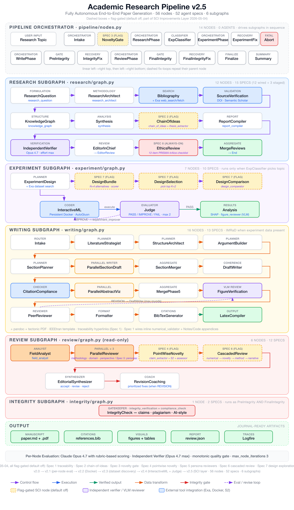

<p align="center">
  <strong>Academic Research Pipeline</strong>
</p>
<p align="center">
  <em>Give it a topic. Get a journal-ready paper. Fully autonomous.</em>
</p>
<p align="center">
  <a href="https://ai.pydantic.dev/"></a>
  <a href="https://logfire-us.pydantic.dev/"></a>
  
</p>

---

An end-to-end academic paper generation pipeline that orchestrates **38 AI agents** across **46 graph nodes** in **five subgraphs**. Claude Opus 4.7 generates and evaluates every critical node. No human input required.

**v2.3.0** adds dataset discovery via Exa search, AutoGluon-based experiments, email alerts when datasets can't be found, and Docker sandboxed execution. The experiment subgraph now designs ML experiments, searches for real public datasets, generates code, executes it in Docker (subprocess fallback), iteratively improves results, runs multi-seed replication, and writes the paper around verified experimental findings.

The key features are:

- **Fully autonomous**: One command produces a complete research paper, from question formulation through peer review.
- **Autonomous ML experiments** (v2.0+): LLM classifier detects when a topic needs experiments. Designs the experiment, searches for real datasets via Exa, generates Python code, runs it in Docker sandbox with AST safety scanning, iteratively improves, runs multi-seed replication, and feeds results into the writing phase.
- **Dataset discovery** (v2.3): Experiment designer uses Exa search to find real public datasets. URL verification before code generation. Email alerts when datasets can't be found. No fabricated data, ever.
- **Monotonic quality gate** (v2.1): Improvement loop reverts if metrics worsen. Multi-seed replication (3 seeds, mean/std aggregation).
- **Per-node evaluation panel**: Every critical node is evaluated by Claude Opus 4.7 with strict rubric-based scoring. Self-correcting locally before handing off.
- **No backward loops**: Straight-line subgraphs. Each node self-corrects locally (max 2 iterations) before handing off. Retry loops live at the orchestrator level only.
- **Independent verification**: Opus 4.7 (with `anthropic_effort: max`) does a second-pass review of research claims and figures, separate from the generator.
- **Crash recovery**: State persists to disk. Rerun with the same `--thread-id` to resume from the last checkpoint.
- **Anti-hallucination**: Agents flag `[MATERIAL GAP]` instead of inventing facts. DOI verification via CrossRef. Retraction checks.
- **Observable**: Full tracing via [Logfire](https://logfire-us.pydantic.dev/). Every agent call, tool use, and state transition is instrumented.

---

## Architecture

<p align="center">
  
</p>

| Stage               | Agents | Nodes | What it does                                                                                                                                                 |
| ------------------- | ------ | ----- | ------------------------------------------------------------------------------------------------------------------------------------------------------------ |
| **Research**        | 11     | 11    | RQ formulation, methodology, bibliography (Exa search), source verification, knowledge graph, synthesis, independent verification, editorial + ethics review |
| **Experiment** (v2.3) | 7    | 7     | Experiment design (Exa dataset search), dataset URL verification, code generation (AutoGluon), Docker execution, domain-theoretic analysis, improvement loop, multi-seed replication |
| **Writing**         | 13     | 16    | Outlining, argument building, parallel section drafting, citation audit, abstract, visualization, figure verification, peer review, formatting               |
| **Review**          | 7      | 4     | Field analysis, 3 parallel peer reviewers (Exa search), editorial synthesis                                                                                  |
| **Integrity**       | 1      | 1     | Claims extraction, plagiarism heuristics, AI style detection                                                                                                 |

### Experiment Subgraph (v2.3.0)

When the classifier determines a topic benefits from computational experiments:

```
ExperimentDesignNode → DatasetVerificationNode → CodeGenerationNode → ExecutionNode → AnalysisNode → ImprovementNode → MultiSeedNode
```

- **Dataset discovery**: Experiment designer searches for real datasets via Exa (`web_search_exa` + `web_fetch_exa`). Anti-fabrication rules in prompt. URL verification before code generation.
- **Docker sandbox** (subprocess fallback): Code runs in Docker container with AST-level safety scanning. API keys not passed by default (`experiment_docker_pass_api_keys=False`). Blocks os.system, subprocess, socket, eval, exec, getattr bypass, from-import bypass.
- **Statistical rigor**: k-fold CV, paired significance tests, bootstrap confidence intervals.
- **Sanity checks**: Flags NaN metrics, suspiciously high accuracy (>0.99), identical results across methods.
- **Monotonic quality gate**: Improvement loop reverts code + results if primary metric worsens.
- **Multi-seed replication**: 3 seeds, regex-based seed injection, mean/std aggregation.
- **Domain-theoretic analysis**: Connects results to field theory, produces baseline comparisons (where we agree/differ/why), alternative explanations, SHAP interpretation.
- **Email alerts**: Sends email via SMTP (configurable from .env) when datasets can't be found. Pipeline pauses for user-provided data.
- **Writing integration**: Auto-switches to IMRaD structure when experiment data present. Passes results, analysis, and figures to StructureArchitect, ArgumentBuilder, SectionDrafter, and DraftWriter nodes.
- **Retry loop**: Up to 3 fix attempts at the orchestrator level. Error history persists across retries.

Disable with `EXPERIMENT_ENABLED=false` in `.env` to restore v1 behavior.

---

**Prerequisites:** Python 3.11-3.13 | [uv](https://docs.astral.sh/uv/) | API keys for [Anthropic](https://console.anthropic.com) + [OpenAI](https://platform.openai.com) + [Exa](https://dashboard.exa.ai). Docker optional. See [INSTALL.md](INSTALL.md) for full setup.

## Quick Start

```bash
# 1. Install (requires uv -- https://docs.astral.sh/uv/)
make setup

# 2. Configure -- edit .env, add your API keys
#    ANTHROPIC_API_KEY, OPENAI_API_KEY, EXA_API_KEY

# 3. Run
make run TOPIC="your research topic"
```

Takes 1-2 hours. Expect $15-40 in API costs per run. Output saved to `output/`.

For fast mode (no evaluation panel): `make run-fast TOPIC="your topic"`

See [INSTALL.md](INSTALL.md) for detailed setup, Docker, configuration, and troubleshooting.

---

## How It Works

### Per-Node Evaluation (Evaluator-Optimizer Pattern)

Every critical node runs a local generate-evaluate-revise loop:

1. **Claude Opus 4.7** generates output with `thinking: effort max`
2. **Opus 4.7 evaluator scores** against a structured rubric (max effort)
3. If all dimensions score >= 7: **PASS** and hand off to next node
4. If any dimension < 7 and iterations < 2: **REVISE** with targeted feedback on the weakest dimension

No backward arrows in the graph. Each node ships quality before handing off.

### Why Independent Verification?

A generating model has blind spots in its own output. A separate Opus 4.7 instance with `effort: max` and a different system prompt catches what the generator missed — citation drift, claims that overstate the data, figures that don't match the prose.

### Agents

All agents are defined via YAML specs co-located with each subgraph (`<sub>/specs/*.yaml`) and loaded with `Agent.from_file()` in per-subgraph `agents.py` registries. Every agent uses `Thinking: effort: xhigh` and `PromptedOutput` for reliable structured output with thinking models.

---

## Output

```
output/
├── rq_brief.md        # Research question + FINER scores
├── bibliography.md    # Full bibliography with annotations
├── synthesis.md       # Literature synthesis
├── paper_draft.md     # Complete paper
├── dashboard.txt      # ASCII progress dashboard
└── review_report.json # Peer review results
```

---

## Development

```bash
uv run ruff check src/academic_pipeline/ tests/ # lint
uv run pyright src/academic_pipeline/            # type check
uv run pytest tests/ -x -q                       # 992 tests
```

## Project Structure

```
src/academic_pipeline/
├── research/        # Research subgraph (agents.py, graph.py, state.py, specs/)
├── experiment/      # Experiment subgraph (v2.3) — design, dataset verify, codegen, execution, analysis, improvement, multi-seed (specs/)
├── writing/         # Writing subgraph (experiment-aware: IMRaD when experiment data present, specs/)
├── review/          # Review subgraph (specs/)
├── integrity/       # Integrity subgraph (specs/)
├── pipeline/        # Orchestrator graph (17 nodes including experiment classifier + retry loops)
├── models/          # Frozen Pydantic domain models split per subgraph (shared, research, writing, review, integrity, experiment)
├── tools/           # DOI verification, Semantic Scholar, citations, integrity, code execution (Docker + subprocess)
├── utils/           # Context builders, evaluator, throttling, trace logger, validators
├── sdk/pipeline.py  # Public async API with crash recovery
├── cli.py           # Typer CLI entry point
└── config.py        # PipelineConfig (pydantic-settings) + centralized paths
docker/
└── experiment/      # Docker sandbox image (Python 3.12 + AutoGluon + ML packages)
references/          # Dynamic agent instructions (anti-leakage, rubrics, disclosure)
skills/              # pydantic-ai-skills for Exa search guidance
```

## Tech Stack

- **Python 3.12+**
- [**PydanticAI**](https://ai.pydantic.dev/) + [**pydantic-graph**](https://ai.pydantic.dev/graph/) — agent framework + graph orchestration
- **Pydantic v2** — frozen models, field validators, `TypeAdapter` for state serialization
- [**Exa**](https://exa.ai/) — academic search (bibliography, reviewer agents, dataset discovery)
- [**AutoGluon**](https://auto.gluon.ai/) — AutoML for tabular, time series, and multimodal experiments
- **Docker** — sandboxed experiment execution (subprocess fallback)
- **Claude Opus 4.7** — primary generator + per-node evaluator + independent verifier (all thinking models, max effort)
- [**Logfire**](https://logfire-us.pydantic.dev/) — observability and tracing
- **Typer** — CLI

## Inspired By

- [**PaperOrchestra**](https://arxiv.org/abs/2604.05018) (Google Cloud AI Research, 2026) — multi-agent paper writing with per-node evaluation and monotonic quality gates
- [**Academic Research Skills**](https://github.com/Imbad0202/academic-research-skills) — expert skills for academic research, paper writing, and evaluation
- [**Karpathy's AutoResearch**](https://github.com/karpathy/autoResearch) — autonomous experiment loop pattern (edit code, run, evaluate, keep/discard)
- [**SciDER**](https://arxiv.org/abs/2603.01421) — data-centric end-to-end research framework with ideation, data analysis, experimentation, and critic agents

## License

MIT
